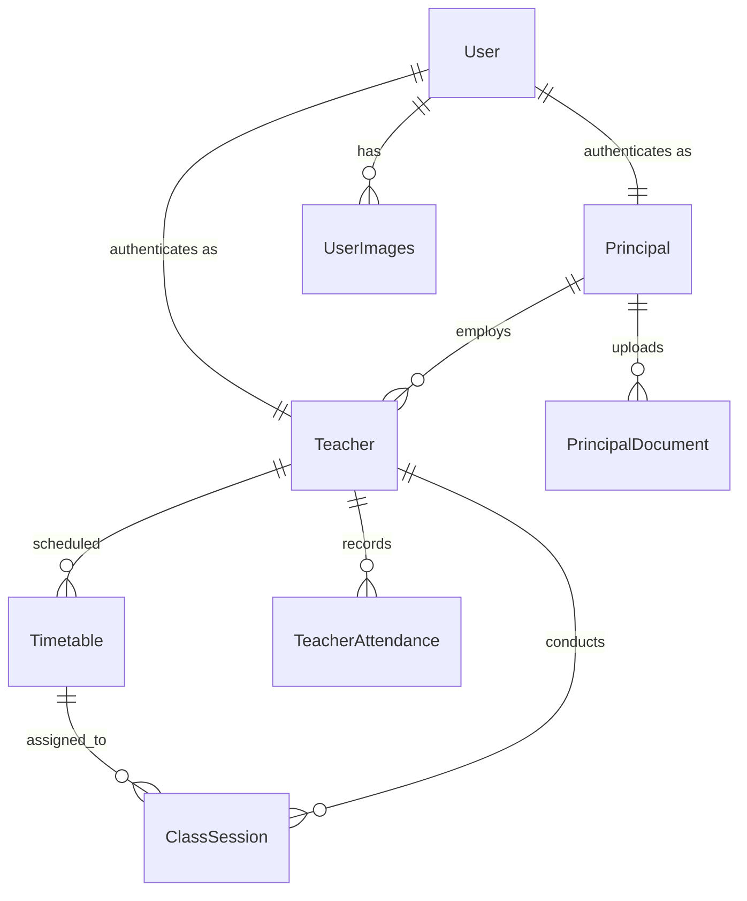

# 🎓 ClassAudit AI — Smart Face Recognition Attendance & Classroom Monitoring System

> **AI-powered biometric attendance, real-time WebSocket classroom monitoring, multi-face presence resolution, and RAG institutional knowledge assistant built for modern educational institutions.**

ClassAudit AI is a production-grade, full-stack Django web application that automates faculty attendance tracking and live classroom presence auditing. It eliminates proxy attendance using **Google MediaPipe 3D Mesh Liveness Verification** and **ArcFace ONNX 512-D embeddings**, paired with a **Groq-powered RAG Institutional Chatbot** (with multi-turn conversation memory), **Django Channels WebSockets** for low-latency live class monitoring, and a dedicated dual-portal architecture for **Principals** and **Teachers**.

---

## 🚀 Key Architectural Upgrades (Production Ready)

- ⚡ **Zero-`dlib` Architecture:** Replaced heavy, slow C++ compiled `dlib` with **Google MediaPipe** and **ONNXRuntime (ArcFace)**. 15x faster inference (~20ms per frame) and zero deployment friction.
- 🛡️ **3-Layer Anti-Spoofing & Liveness:** Defeats photo attacks, digital display replays, and video spoofs using 468-point 3D facial depth curvature ($Z$-gradient), screen glare spectral filtering, and natural blink detection ($EAR$).
- 👥 **Multi-Face Presence Resolution:** Classrooms are rarely empty! Instead of dropping frames when students or staff walk in front of the camera, the system detects all faces and locates the authorized teacher in the crowd via cosine distance matching.
- 🌐 **Real-Time WebSockets (Django Channels + Daphne):** Eliminated continuous 5-second HTTP polling and repetitive TCP/CSRF overhead. A single persistent WebSocket connection (`ws://<host>/ws/attendance/`) streams frames and returns instant verification.
- 📉 **Client-Side Face Pre-Filtering:** Integrated browser hardware-accelerated `FaceDetector` API to drop empty-room network traffic, cutting server bandwidth and idle CPU usage to zero.
- 💬 **Multi-Turn RAG Conversation Memory:** Principals and teachers can ask natural follow-up questions ("What if I arrive late?", "What are the leave rules?"). The chatbot maintains rolling session context while answering strictly from uploaded institutional policies (PDF, TXT, MD) via **LLaMA 3.3 70B** on Groq.
- 🗄️ **Database Scalability (SQLite Dev ↔ PostgreSQL Prod):** Built-in connection pooling (`CONN_MAX_AGE=60`), connection health checks, and statement timeouts with seamless `.env`-driven database switching.

---

## ✨ Key Features

### 🔐 Biometric & Role-Based Authentication
- **Face Recognition Login** — Scan face via webcam with real-time 3D liveness verification.
- **3D Depth Anti-Spoofing** — Analyzes facial curvature ($Z$-gradient) to reject 2D screen playback and paper photos.
- **Natural Blink Verification** — Burst temporal analysis (8 frames / 2.0s) verifies living human dynamic.
- **Password Fallback** — Traditional username/password authentication available for all roles.
- **Strict Role-Based Access** — Distinct portals, dashboards, and permission layers for Principals and Teachers.

### 👨‍💼 Principal Portal (Admin Hub)
- **Institution Dashboard** — Overview of all faculty grouped by department, live present/late/absent metrics.
- **Teacher Registration** — Register teachers with webcam face enrollment (stores normalized 512-D ArcFace vectors).
- **Weekly Timetable Scheduling** — Assign and manage weekly class periods (MON–SAT) per teacher.
- **Attendance & Defaulter Reports** — Filter by date, month, and year; one-click CSV export of defaulters.
- **Performance Analytics** — Visual Chart.js charts for departmental teaching distribution and active duration.
- **AI Knowledge Management** — Upload institutional handbooks, leave policies, and SOPs for the RAG chatbot.

### 👩‍🏫 Teacher Portal
- **Teacher Dashboard** — Daily scheduled classes, class history timeline, and calendar widget.
- **Profile & Analytics** — Monthly attendance records, active teaching hours, and session stats.
- **Daily Attendance Check-In** — One-tap facial scan with automatic Present/Late timestamping.
- **Live WebSocket Class Monitoring** — Real-time continuous biometric monitoring via WebSocket. Session active duration increments only when the authorized teacher is physically verified.
- **Multi-Face Tolerance** — Attendance continues uninterrupted even if students enter the camera frame.
- **Class Session History** — Filterable history of past conducted sessions with verified active durations.
- **Institutional AI Assistant** — Floating chat widget to query school policies, leaves, and guidelines with multi-turn memory.

### 🧠 RAG Institutional Assistant (`chatbot/rag_engine.py`)
- **Isolated Knowledge Collections** — Multi-tenant ChromaDB storage per principal (`principal_<id>`).
- **Semantic Text Ingestion** — Paragraph-aware chunking (600 characters, 100 overlap) with Markdown sanitization.
- **Local Embedding Engine** — `sentence-transformers` (`all-MiniLM-L6-v2`) generating 384-D dense vectors.
- **Multi-Turn Context Memory** — Maintains rolling conversation history (last 6 turns / 3 Q&A pairs) for contextual follow-up questions.
- **Grounded Generation** — Groq API hosting **LLaMA 3.3 70B** with strict guardrails against hallucinations.

---

## 🏗️ Modern Tech Stack

| Layer | Technology |
|---|---|
| **Backend Framework** | Python 3.10+, Django 5.1.3 |
| **Asynchronous & WebSockets** | Django Channels 4.1, Daphne 4.1 (ASGI) |
| **Database** | SQLite3 (Development) / PostgreSQL with Connection Pooling (Production) |
| **Face Detection & Mesh** | Google MediaPipe 0.10.14 (FaceDetection & 468-point 3D FaceMesh) |
| **Face Recognition Engine** | ArcFace MobileFaceNet (ONNX Runtime 1.23, 512-D embeddings) |
| **Face Matching** | Cosine Distance Metric (`1 - np.dot(u, v)`) with threshold `0.45` |
| **Anti-Spoofing / Liveness** | 3D Curvature $Z$-Analysis + Screen Glare Filter + Eye Aspect Ratio ($EAR$) |
| **RAG Vector Database** | ChromaDB (Persistent, Multi-Tenant per Principal) |
| **Embeddings (RAG)** | `sentence-transformers` (`all-MiniLM-L6-v2`, 384-D) |
| **LLM Inference** | Groq API (`openai/gpt-oss-120b` / LLaMA 3.3 70B) |
| **Frontend** | HTML5, Vanilla CSS (18 modular stylesheets), Vanilla JavaScript |
| **Data Visualizations** | Chart.js |
| **Typography & Icons** | Font Awesome 6.4, Plus Jakarta Sans, Nunito, Inter |

---

## 📁 Project Structure

```
face-recognition-authentication/
├── facere/                          # Django project configuration
│   ├── settings.py                  # Core settings, DB router, Channels config
│   ├── urls.py                      # Root URL router
│   ├── wsgi.py                      # WSGI server gateway
│   └── asgi.py                      # ProtocolTypeRouter (HTTP + Channels WebSocket)
│
├── accounts/                        # Authentication & Core App
│   ├── models.py                    # 6 Core DB models (Principal, Teacher, ClassSession, etc.)
│   ├── views.py                     # Views for auth, portal, monitoring, and analytics
│   ├── consumers.py                 # Async WebSocket consumer for live attendance streaming
│   ├── routing.py                   # WebSocket URL patterns (/ws/attendance/)
│   ├── utils/                       # Zero-dlib Biometric Utilities
│   │   ├── face_detector.py         # MediaPipe face detection (<10ms)
│   │   ├── face_embedding.py        # 512-D ArcFace ONNX inference & multi-face locator
│   │   ├── face_matcher.py          # Normalized cosine distance matching
│   │   └── liveness_detector.py     # 3D depth, screen glare, and EAR blink liveness
│   └── templates/                   # UI Templates (Principal & Teacher portals)
│
├── chatbot/                         # RAG Chatbot Application
│   ├── rag_engine.py                # Multi-turn RAG, ChromaDB collections, Groq LLM
│   ├── views.py                     # Chat endpoint with session memory & clear API
│   ├── urls.py                      # Chatbot HTTP routes
│   └── templates/chatbot/           # Standalone chat & document management UI
│
├── models/                          # Lightweight AI Model Weights
│   └── mobilefacenet.onnx           # Auto-downloaded ArcFace ONNX model
│
├── data/users/                      # User embedding vectors (embeddings.npy)
├── media/                           # User profile pictures & institutional PDFs
├── chroma_db/                       # Persistent vector database store
├── static/                          # Modular CSS, JS, and brand assets
├── manage.py                        # Django CLI entrypoint
└── requirements.txt                 # Python dependencies
```

---

## 🗃️ Database Schema



---

## 🔄 Real-Time Attendance & Biometric Flow

```
┌─────────────────────────────────┐      ┌──────────────────────────────────┐      ┌──────────────────────────────────┐
│     Teacher Registration        │      │       Biometric Login            │      │  Live Class Monitoring (WS)      │
│                                 │      │                                  │      │                                  │
│  1. Capture photo via webcam    │      │  1. 8-frame burst (2.0s)         │      │  1. Persistent WS connection     │
│  2. MediaPipe detects face      │      │  2. Reject screen glare / photos │      │  2. Browser FaceDetector precheck│
│  3. ArcFace outputs 512-D vector│      │  3. Verify 3D depth & blink      │      │  3. 3D depth & liveness check    │
│  4. Save normalized vector .npy │      │  4. Match vector (distance<0.45) │      │  4. Locate teacher in crowd      │
│                                 │      │  5. Authenticate session         │      │  5. Active duration += 5 secs    │
└─────────────────────────────────┘      └──────────────────────────────────┘      └──────────────────────────────────┘
```

---

## 🚀 Getting Started

### Prerequisites
- **Python 3.10 or 3.11**
- **pip** and **git**
- *(Zero C++ compiler or CMake required!)*

### 1. Clone & Setup Virtual Environment
```bash
git clone https://github.com/Akhandbhadouria/ClassAudit-AI.git
cd ClassAudit-AI

python3 -m venv venv
source venv/bin/activate       # On Windows: venv\Scripts\activate
```

### 2. Install Dependencies
```bash
pip install -r requirements.txt
pip install mediapipe==0.10.14 onnxruntime
```

### 3. Configure Environment Variables
Create a `.env` file in the project root:
```env
SECRET_KEY=your-django-secret-key
DEBUG=True
ALLOWED_HOSTS=localhost,127.0.0.1
GROQ_API_KEY=your-groq-api-key

# Database (SQLite by default, PostgreSQL for production)
DB_ENGINE=django.db.backends.sqlite3
DB_NAME=mydatabase

# For PostgreSQL production:
# DB_ENGINE=django.db.backends.postgresql
# DB_NAME=classaudit_db
# DB_USER=your_db_user
# DB_PASSWORD=your_db_password
# DB_HOST=localhost
# DB_PORT=5432
# DB_CONN_MAX_AGE=60
```

### 4. Run Migrations & Start Server
ClassAudit AI uses ASGI (Django Channels + Daphne) to power WebSockets:
```bash
python manage.py migrate

# Start with Daphne (ASGI server with full WebSocket support):
daphne -p 8000 facere.asgi:application

# Or run standard Django dev server (Daphne auto-wraps runserver):
python manage.py runserver
```

Open [http://127.0.0.1:8000/](http://127.0.0.1:8000/) in your web browser.

---

## 🧪 Testing Verification & Liveness

1. **Register as Principal:** Sign up, log in to the Principal Dashboard, and click **Add Teacher**.
2. **Add Teacher:** Position the teacher in front of the camera to save biometric vectors.
3. **Face Login:** Log out and go to **Face Login**. The system will verify 3D face depth and natural blink dynamics before granting access.
4. **Anti-Spoofing Check:** Try holding a printed photo or phone screen up to the webcam — the system rejects it with **"2D spoof detected"** or **"Screen glare detected"**.
5. **Live Monitoring (WebSocket):** Start a scheduled class from the timetable. The browser opens a persistent WebSocket connection, streaming verification every 5 seconds.
6. **Multi-Face Classroom Test:** Have another person stand next to the teacher. Notice how the system successfully locates the teacher and keeps active monitoring going: *"Authorized (Teacher identified among 2 people)"*.
7. **Multi-Turn Chatbot Test:** Open the AI chatbot, ask *"What is the attendance policy?"*, then follow up with *"What if I arrive 15 minutes late?"* to observe context memory in action.

---

## 📄 License
This project is open-source and developed for educational and institutional research purposes.
