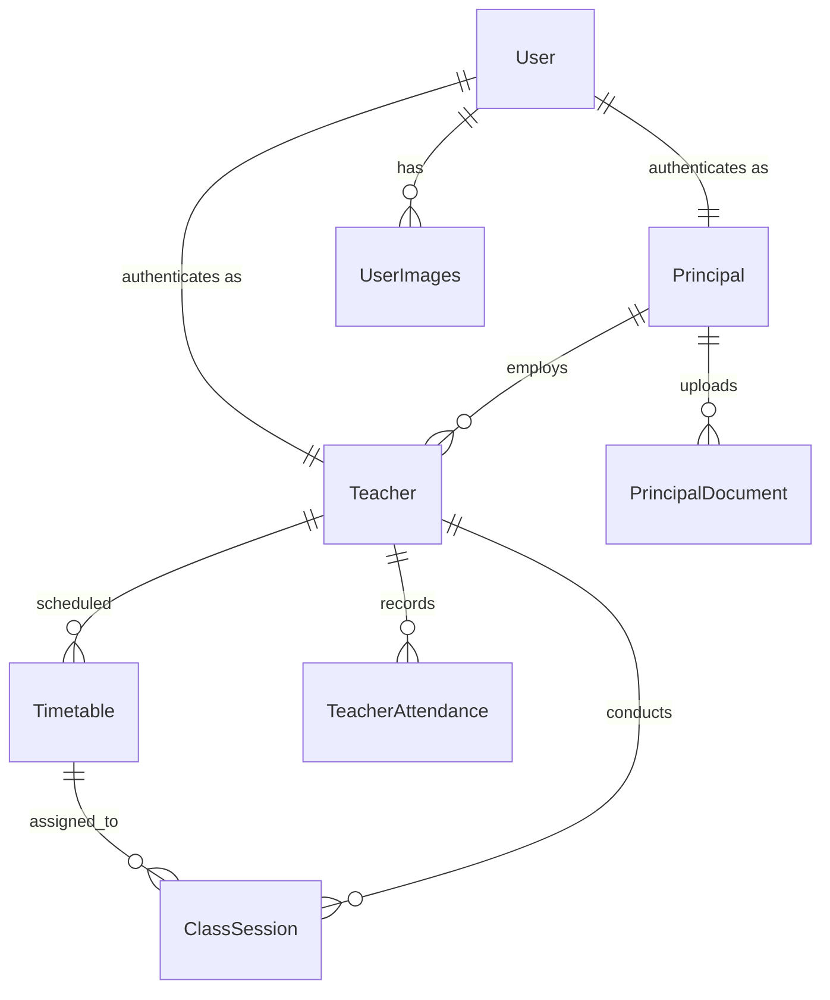

# 🎓 ClassAudit AI — Smart Face Recognition Attendance & Monitoring System

> **AI-powered biometric attendance, real-time classroom monitoring, and RAG institutional knowledge assistant built for modern educational institutions.**

ClassAudit AI is a production-grade, full-stack Django web application that automates teacher attendance tracking and live classroom presence auditing. It eliminates proxy attendance using **Google MediaPipe 3D Mesh Liveness Verification** and **ArcFace ONNX 512-D embeddings**, paired with a **Groq-powered RAG Institutional Chatbot** and a dedicated dual-portal architecture for **Principals** and **Teachers**.

---

## 🚀 What's New in 2026 Update (Major Architecture Upgrade)

- ⚡ **Zero-`dlib` Architecture:** Replaced heavy, slow C++ compiled `dlib` with **Google MediaPipe** and **ONNXRuntime (ArcFace)**. 15x faster inference (~20ms per frame) and zero deployment friction.
- 🛡️ **3-Layer Anti-Spoofing & Liveness:** Defeats photo attacks, digital display replays, and video spoofs using 468-point 3D facial depth curvature, screen glare filtering, and natural blink detection.
- 📉 **Client-Side Face Pre-Filtering:** Integrated browser hardware-accelerated detection to drop empty-room network traffic, cutting server bandwidth and idle CPU usage to zero.
- 🧠 **Multi-Tenant RAG Knowledge Base:** Principals can upload school policies (PDF, TXT, MD) into isolated ChromaDB collections; teachers and admins query rules answered strictly by **LLaMA 3.3 70B** via Groq API with cited sources.

---

## ✨ Key Features

### 🔐 Biometric & Role-Based Authentication
- **Face Recognition Login** — Scan face via webcam with real-time liveness verification.
- **3D Depth Anti-Spoofing** — Analyzes facial curvature (Z-gradient) to reject 2D screen playback and paper photos.
- **Natural Blink Verification** — Burst temporal analysis (8 frames / 2.0s) verifies living human dynamic.
- **Password Fallback** — Traditional username/password authentication available for all roles.
- **Strict Role-Based Access** — Distinct portals, dashboards, and permission layers for Principals and Teachers.

### 👨‍💼 Principal Portal (Admin Hub)
- **Institution Dashboard** — Overview of all faculty grouped by department, live present/late/absent metrics.
- **Teacher Registration** — Register teachers with webcam face enrollment (stores normalized 512-D ArcFace vectors).
- **Weekly Timetable Scheduling** — Assign and manage weekly class periods (MON–SAT) per teacher.
- **Attendance & Defaulter Reports** — Filter by date, month, and year; one-click CSV export of defaulters.
- **Performance Analytics** — Visual Chart.js charts for departmental teaching distribution and active duration.
- **AI Knowledge Management** — Upload institutional handbooks, leave policies, and SOPs for the RAG chatbot.

### 👩‍🏫 Teacher Portal
- **Teacher Dashboard** — Daily scheduled classes, class history timeline, and calendar widget.
- **Profile & Analytics** — Monthly attendance records, active teaching hours, and session stats.
- **Daily Attendance Check-In** — One-tap facial scan with automatic Present/Late timestamping.
- **Live Class Presence Monitoring** — Real-time continuous biometric monitoring every 5 seconds. Session active duration increments only when the authorized teacher is physically verified in front of the camera.
- **Class Session History** — Filterable history of past conducted sessions with verified active durations.
- **Institutional AI Assistant** — Floating chat widget to query school policies, leaves, and guidelines anytime.

### 🧠 RAG Institutional Assistant (`rag_engine.py`)
- **Isolated Knowledge Collections** — Multi-tenant ChromaDB storage per principal (`principal_<id>`).
- **Semantic Text Ingestion** — Paragraph-aware chunking (600 characters, 100 overlap) with Markdown sanitization.
- **Local Embedding Engine** — `sentence-transformers` (`all-MiniLM-L6-v2`) generating 384-D dense vectors.
- **Grounded Generation** — Groq API hosting **LLaMA 3.3 70B** with strict guardrails against hallucinations.

---

## 🏗️ Modern Tech Stack

| Layer | Technology |
|---|---|
| **Backend Framework** | Python 3.10+, Django 5.x / 6.0 |
| **Database** | SQLite3 (Development) / PostgreSQL compatible |
| **Face Detection & Mesh** | Google MediaPipe (FaceDetection & 468-point 3D FaceMesh) |
| **Face Recognition Engine** | ArcFace ResNet100 (ONNX Runtime, 512-D embeddings) |
| **Face Matching** | Cosine Distance Metric (`1 - np.dot(u, v)`) |
| **Anti-Spoofing / Liveness** | 3D Curvature Z-Analysis + Screen Glare Filter + Eye Aspect Ratio (EAR) |
| **RAG Vector Database** | ChromaDB (Persistent, Multi-Tenant) |
| **Embeddings (RAG)** | `sentence-transformers` (`all-MiniLM-L6-v2`) |
| **LLM Inference** | Groq API (`openai/gpt-oss-120b` / LLaMA 3.3 70B) |
| **Frontend** | HTML5, Vanilla CSS (18 modular stylesheets), Vanilla JavaScript |
| **Data Visualizations** | Chart.js |
| **Typography & Icons** | Font Awesome 6.4, Plus Jakarta Sans, Nunito, Inter |

---

## 📁 Project Structure

```
face-recognition-authentication/
├── facere/                          # Django project configuration
│   ├── settings.py                  # Core settings, apps, auth, and DB config
│   ├── urls.py                      # Root URL router
│   ├── wsgi.py                      # WSGI server gateway
│   └── asgi.py                      # ASGI asynchronous gateway
│
├── accounts/                        # Authentication & Core App
│   ├── models.py                    # 6 Core DB models (Principal, Teacher, ClassSession, etc.)
│   ├── views.py                     # Views for auth, portal, monitoring, and analytics
│   ├── utils/                       # Zero-dlib Biometric Utilities
│   │   ├── face_detector.py         # MediaPipe face detection (<10ms)
│   │   ├── face_embedding.py        # 512-D ArcFace ONNX inference
│   │   ├── face_matcher.py          # Normalized cosine distance matching
│   │   └── liveness_detector.py     # 3D depth, screen glare, and EAR blink liveness
│   └── templates/                   # UI Templates (Principal & Teacher portals)
│
├── chatbot/                         # RAG Chatbot Application
│   ├── rag_engine.py                # Ingestion, ChromaDB storage, Groq LLM integration
│   ├── views.py                     # Chat endpoint & document management views
│   └── templates/chatbot/           # Standalone chat & document management UI
│
├── models/                          # Lightweight AI Model Weights
│   └── mobilefacenet.onnx           # Auto-downloaded ArcFace ONNX model
│
├── data/users/                      # User embedding vectors (embeddings.npy)
├── media/                           # User profile pictures & institutional PDFs
├── chroma_db/                       # Persistent vector database store
├── static/                          # Modular CSS, JS, and brand assets
├── manage.py                        # Django CLI entrypoint
└── requirements.txt                 # Python dependencies
```

---

## 🗃️ Database Schema



---

## 🔄 How the Biometric Engine Works

```
┌─────────────────────────────────┐      ┌──────────────────────────────────┐      ┌─────────────────────────────────┐
│     Teacher Registration        │      │       Biometric Login            │      │     Live Class Monitoring       │
│                                 │      │                                  │      │                                 │
│  1. Capture photo via webcam    │      │  1. 8-frame burst (2.0s)         │      │  1. Capture frame every 5s      │
│  2. MediaPipe detects face      │      │  2. Reject screen glare / photos │      │  2. Client-side face pre-filter │
│  3. ArcFace outputs 512-D vector│      │  3. Verify 3D depth & blink      │      │  3. 3D depth & liveness check   │
│  4. Save normalized vector .npy │      │  4. Match vector (distance<0.45) │      │  4. ArcFace match with teacher  │
│                                 │      │  5. Authenticate session         │      │  5. Active duration += 5 secs   │
└─────────────────────────────────┘      └──────────────────────────────────┘      └─────────────────────────────────┘
```

---

## 🚀 Getting Started

### Prerequisites
- **Python 3.10 or 3.11**
- **pip** and **git**
- *(No C++ compiler or CMake required!)*

### 1. Clone & Setup Virtual Environment
```bash
git clone https://github.com/Akhandbhadouria/ClassAudit-AI.git
cd ClassAudit-AI

python3 -m venv venv
source venv/bin/activate       # On Windows: venv\Scripts\activate
```

### 2. Install Dependencies
```bash
pip install -r requirements.txt
pip install mediapipe==0.10.14 onnxruntime
```

### 3. Configure Environment Variables
Create a `.env` file in the project root:
```env
SECRET_KEY=your-django-secret-key
DEBUG=True
ALLOWED_HOSTS=localhost,127.0.0.1
GROQ_API_KEY=your-groq-api-key
```

### 4. Run Migrations & Start Server
```bash
python manage.py migrate
python manage.py runserver
```

Open [http://127.0.0.1:8000/](http://127.0.0.1:8000/) in your web browser.

---

## 🧪 Testing Verification & Liveness

1. **Register as Principal:** Sign up, log in to the Principal Dashboard, and click **Add Teacher**.
2. **Add Teacher:** Position yourself in front of the camera to save your facial biometrics.
3. **Face Login:** Log out and go to **Face Login**. The system will verify your 3D presence and natural blink before logging in.
4. **Anti-Spoofing Check:** Try showing a photo or playing a video on a phone in front of the webcam — the system will reject it with a **"2D spoof detected"** or **"Screen glare detected"** security alert.
5. **Live Monitoring:** Start a class from the timetable and monitor real-time presence accumulation.

---

## 📄 License
This project is open-source and developed for educational and institutional research purposes.
